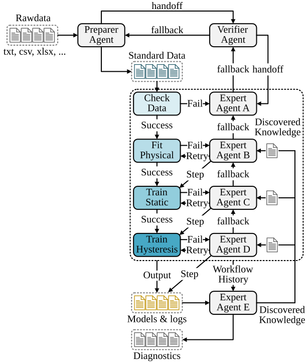

# SemiForge

<div align="center">
  
</div>

## SemiForge 智能体工作流 | SemiForge Agent Workflow
SemiForge 是一个面向可迁移半导体器件仿真的，物理-KAN符号化紧凑建模框架，具备约束LLM智能体工作流。仅需一句用户提示词与原始数据，SemiForge 即可从零开始生成具有高拟合精度的，SPICE开箱即用的紧凑模型。

SemiForge is a symbolic physics-KAN compact modeling framework with constrained LLM-agent workflow for transferable device simulation. With only single user prompt and raw data, SemiForge can produce SPICE-ready compact model from scratch with high fitting accuracy.

> 本项目基于 [TECoSim-Agent](https://github.com/YunTing-k/TECoSim-Agent) V0.2.4 开发 / This project is built on [TECoSim-Agent](https://github.com/YunTing-k/TECoSim-Agent) V0.2.4

## 简介 | Introduction
### 背景 | Background

随着新兴电子器件快速发展，紧凑模型的开发效率和可迁移性成为瓶颈。基于物理机理的紧凑模型可解释性强，但严重依赖专家经验与手动试错，周期漫长、迁移困难。基于神经网络的方法拟合能力出色，却缺乏物理可解释性，参数规模庞大且在分布外条件下性能急剧退化。

Rapid advances in emerging electronic devices have made compact model efficiency and transferability critical bottlenecks. Physics-based compact models are interpretable but rely heavily on expert insight and trial-and-error, with slow iteration cycles and poor transferability. Neural-network-based approaches offer strong fitting capability but are black-box, parameter-heavy, and degrade sharply under out-of-distribution conditions.

### 项目贡献 | Contribution of this Project

为解决以上问题，SemiForge 以物理方程为主干、KAN修正为补充，引入约束的LLM智能体工作流，将数据训练出的B样条曲线蒸馏为紧凑解析公式，自动化迭代调参与结果诊断，无需专家介入。

To address above issues, SemiForge combines a physics-based core with KAN corrections, driven by a constrained LLM-agent workflow. It distills trainable B-spline curves into compact analytic formulas and automates iterative parameter tuning and result diagnosis without expert intervention.

<div align="center">
  
</div>

**主要特性 | Key Features**

| # | 特性 Feature | 说明 Description |
|---|-------------|------------------|
| 1 | **通用智能体平台** General Agent Platform | 内置工具与权限系统、子Agent并发协作、任务看板、MCP接入、Agent技能框架 / Built-in tools & permissions, parallel subagents, scoreboard, MCP servers, Agent skill framework |
| 2 | **KAN符号化建模管线** KAN Symbolic Modeling Pipeline | 物理内核解析I-V/C-V拟合基线参数 → 基础KAN学习偏压依赖B样条修正 → 迟滞KAN捕获I-t瞬态陷阱动力学 / Physical core fits I-V/C-V for baseline parameters → Base KAN learns bias-dependent B-spline corrections → Hysteresis KAN captures I-t transient trap dynamics |
| 3 | **最终化与导出** Finalize & Export | B样条边剪枝并替换为解析函数原语，输出闭式Verilog-A模型 / B-spline edges pruned and replaced with analytic primitives, producing closed-form Verilog-A model |
| 4 | **多智能体编排** Multi-Agent Orchestration | Preparer/Verifier/Agent-A-E 按序编排，覆盖四阶段全流程 / Preparer, Verifier, and expert agents (A-E) orchestrated sequentially across all four stages |
| 5 | **结构化约束决策** Structured Decisions | 专家智能体受限输出三种决策（adjust_params/fallback/accept_quality），字段预声明类型边界，拒绝自由文本 / Expert agents emit structured decisions with pre-declared types and bounds, free-text outputs always rejected |
| 6 | **全链路可追溯** Full Traceability | 每轮调参、拟合指标、交接上下文完整记录，Agent E提取可复用洞察形成增长知识库 / Every tuning attempt, fitting metric, and handoff context fully recorded; Agent E synthesizes reusable insights into a growing knowledge base |

---

## 快速开始 | Quick Start

### 环境要求 | Requirements

- **Python**: 3.12.x (e.g., 3.12.11)
- **操作系统 OS**: Windows / Linux (CUDA required) / macOS (Agent only, no CUDA)
- **GPU**: NVIDIA GPU with CUDA 12.8+（建模环境 / for modeling environment）

**双解释器架构**：SemiForge 采用 Agent 与 Modeling 两个独立 Python 环境，分别满足 `requirements_agent.txt` 和 `requirements_cuda.txt`
**Dual interpreter architecture**: SemiForge uses two separate Python environments — one for the Agent and one for Modeling — satisfying `requirements_agent.txt` and `requirements_cuda.txt` respectively

### 安装与配置 | Installation and Configuration

以下以 `venv` 为例创建虚拟环境（也可使用 `conda` 等工具）：
The following uses `venv` as an example (`conda` or other virtual environment tools also work):

```bash
# 1. 克隆仓库 | Clone the repository
git clone https://github.com/YunTing-k/SemiForge.git
cd SemiForge

# 2. 创建 Agent 虚拟环境 | Create the Agent virtual environment
python -m venv venv_agent
source venv_agent/bin/activate      # Linux / macOS
venv_agent\Scripts\activate         # Windows
pip install -r requirements_agent.txt

# 3. 创建 Modeling 虚拟环境（需 CUDA GPU）| Create the Modeling virtual environment (requires CUDA GPU)
python -m venv venv_cuda
source venv_cuda/bin/activate       # Linux / macOS
venv_cuda\Scripts\activate          # Windows
pip install -r requirements_cuda.txt
```
安装后，还需要配置 `./config/` 下的文件：

### 1. 解释器配置 | Interpreter Configuration (`agent_configs.json`)

安装依赖后，编辑 `config/agent_configs.json`，将两个解释器路径指向对应的虚拟环境：
After installing dependencies, edit `config/agent_configs.json` to point both interpreter paths to their respective virtual environments:

```json
{
  "DG_TFT_AGENT_PYTHON_EXE": "/path/to/venv_agent/bin/python",
  "DG_TFT_MODELING_PYTHON_EXE": "/path/to/venv_cuda/bin/python"
}
```

### 2. API 连接配置 | API Connection (`api_configs.json`)

设置 LLM API 端点、密钥与模型分层：
Set your LLM API endpoint, key, and model tiering:

| 参数 Parameter | 说明 Description |
|-----------|-------------|
| `API_URL` | API 基地址 / API base URL (e.g., `https://api.deepseek.com`) |
| `API_KEY` | API 认证密钥 / API authentication key |
| `TIMEOUT_MS` | 请求超时（毫秒）/ Request timeout (ms) |
| `MAIN_MODEL_NAME` | 主模型，用于复杂多步推理 / Main model for complex multi-step reasoning |
| `MAIN_MODEL_*` | 主模型配套参数（上下文窗口、温度、推理开关、`max_tokens` 等）/ Companion params for the main model (context, temperature, reasoning, `max_tokens`, etc.) |
| `MEDIUM_MODEL_NAME` | 中等模型，用于结构化决策等中等复杂度任务 / Medium model for structured decisions and moderate-complexity tasks |
| `MEDIUM_MODEL_*` | 中等模型配套参数 / Companion params for the medium model |
| `FAST_MODEL_NAME` | 快速模型，用于分类、校验等简单任务 / Fast model for classification, validation, and simple tasks |
| `FAST_MODEL_*` | 快速模型配套参数 / Companion params for the fast model |

### 3. Agent 运行参数 | Agent Runtime (`agent_configs.json`)

| 参数 Parameter | 默认值 Default | 说明 Description |
|-----------|---------|----------------|
| `BASH_PATH` | `"bash"` | **GNU Bash** 的路径（不支持 cmd/pwsh，见下文）/ Path to **GNU Bash** (cmd/pwsh not supported) |
| `RIPGREP_PATH` | `"rg"` | `ripgrep` 可执行文件路径 / Path to `ripgrep` executable |
| `WEB_SEARCH_BACKEND` | `"DDGS"` | 网络搜索后端，可选：`Exa`、`Tavily`、`Linkup`、`DDGS` / Set to enable web search |
| `WEB_SEARCH_API_KEY` | `" "` | 网络搜索 API Key / API key for your web search backend |

**`BASH_PATH` 必须指向 GNU Bash** Agent 通过 `bash -c` 执行命令，并内置基于 Bash 语义的风险检测引擎。Windows操作系统可使用`git bash`。
**`BASH_PATH` must point to GNU Bash** The agent executes commands via `bash -c` with Bash-semantics-based risk detection. For Windows OS, please use `git bash`.

> **⚠️ 安全建议 | Security Advisory** — Agent 可通过 `bash` 执行任意系统命令，风险检测并非绝对可靠。强烈建议在沙箱环境（Docker/VM/隔离服务器）中以最小权限账户运行，并用 `/readonly_add` 保护关键路径。
> The agent can execute arbitrary system commands via `bash`. Risk detection is not infallible. Run in a sandbox (Docker/VM/isolated server) with least-privilege account; use `/readonly_add` to protect critical paths.

**ripgrep** — `grep_file` 工具依赖 ripgrep（`rg`）。安装：`winget install BurntSushi.ripgrep`（Win）/ `sudo apt install ripgrep`（Linux）/ `brew install ripgrep`（macOS）。或在 `agent_configs.json` 中设 `RIPGREP_PATH`。
**ripgrep** — the `grep_file` tool requires ripgrep (`rg`). Install via your package manager, or set `RIPGREP_PATH` in `agent_configs.json`.

> 完整参数列表请参阅 | See [Configuration Reference](./doc/configuration.md) for all available parameters.

### 首次启动 | First Launch

```bash
python -m src.main
```

这里的 `python` 应为 `DG_TFT_AGENT_PYTHON_EXE` 指向的解释器。启动前请确保已完成上述所有基础配置。
The `python` here should be the interpreter pointed to by `DG_TFT_AGENT_PYTHON_EXE`. Make sure all essential configurations above have been completed before launching.

加载完毕后即可在输入框下达指令，例如：`"Fit device with raw test data in 'D:/my_testdata/'"`。这就是建模所需要的全部操作，等待 SemiForge 输出产物即可。流程结束后可以进一步询问 Agent 相关细节。

Once loaded, type your instruction in the prompt, e.g.: `"Fit device with raw test data in 'D:/my_testdata/'"`. That is all you need to do — wait for SemiForge to produce the output. After the workflow completes, you can further ask the agent about details.

> 更详细使用说明请参阅 | See [Basic Usage](./doc/basic_usage.md) for detailed usage.

---

## 多Agent协作 | Subagent Coordination

SemiForge 内置二类子智能体：通用平台智能体与 DG-TFT 工作流专用智能体。所有子智能体均支持**前台**（阻塞等待结果）和**后台**（异步完成自动通知）两种运行模式。
SemiForge provides two categories of subagents: generic platform agents and DG-TFT workflow-specific agents. All subagents support **foreground** (blocking) and **background** (async with auto-notification) modes.

### 通用智能体 | Generic Agents

| Agent 类型 Type | 能力 Capability |
|----------------|---------------|
| `explorer` | 只读代码探索、文件搜索、网页获取与搜索 / Read-only code exploration, file search, web fetch & search |
| `worker` | 完整工具集的通用任务执行（含文件读写、编辑、Shell）/ General-purpose implementation with full toolset (file I/O, editing, bash) |
| `scheduler` | 共享任务看板，负责任务分解、依赖规划与状态流转 / Shared scoreboard for task decomposition, dependency planning, and state management |

### DG-TFT 工作流智能体 | DG-TFT Workflow Agents

| Agent 类型 Type | 角色 Role | 能力 Capability |
|----------------|--------|---------------|
| `preparer` | 数据准备 / Preparer | 将原始 CSV/XLSX 测量文件转换为标准化 `*_train.xlsx` / Converts raw CSV/XLSX measurement files into standardized `*_train.xlsx` |
| `verifier` | 数据校验 / Verifier | 检查 `*_train.xlsx` 的 sheet 结构、必需列与数据完整性 / Inspects `*_train.xlsx` sheet structure, required columns, and data integrity |
| `diagnostic` | 故障诊断 / Agent A | 分析 check-data 校验失败原因，决定回退策略 / Analyzes check-data validation failures and decides fallback strategy |
| `modeling` | 参数调优 / Agents B·C·D | 审查阶段结果与质量指标，输出 adjust_params / fallback / accept 三种结构化决策 / Reviews stage results and quality metrics, emits structured adjust_params / fallback / accept decisions |
| `interpreter` | 最终解读 / Agent E | 审阅 operation_log 全链路记录，推荐最佳 attempt 链，提取可复用洞察写入知识库 / Reviews full operation_log, recommends best attempt chain, and extracts reusable insights into the knowledge base |

---

## 延伸阅读 | Further Reading

- [基本使用 | Basic Usage](./doc/basic_usage.md) — 命令行参数、子命令与内建命令参考 / CLI arguments, sub-commands, and built-in command reference
- [配置参数参考 | Configuration Reference](./doc/configuration.md) — `api_configs.json` & `agent_configs.json` 完整参数说明 / All parameter descriptions for API and agent runtime configs
- [模型部署 | Model Deployment](./doc/deployment.md) — Verilog-A 模型导出与 HSPICE/仿真器集成 / Verilog-A model export and HSPICE/simulator integration
- [MCP 与 Skills 设置指南 | MCP & Skills Setup Guide](./doc/mcp_skills_setup.md) — MCP 服务器与技能详细设置指南 / Detailed setup guide for MCP servers and skills
- [知识模板 | Knowledge Template](./doc/knowledge_template.md) — 专家知识库条目模板 / Template for expert knowledge base entries
- [开发日志 (中文)](./doc/DEV_LOG_zh.md) / [Dev Log (English)](./doc/DEV_LOG_en.md) — 开发决策与变更记录 / Development decisions and change log

## 致谢 | Acknowledgements

- [YunTing-k@github](https://github.com/YunTing-k) — 智能体框架与项目架构 / Agent framework & project architecture
- [Latias201@github](https://github.com/Latias201) — KAN 建模算法 / KAN modeling algorithms
